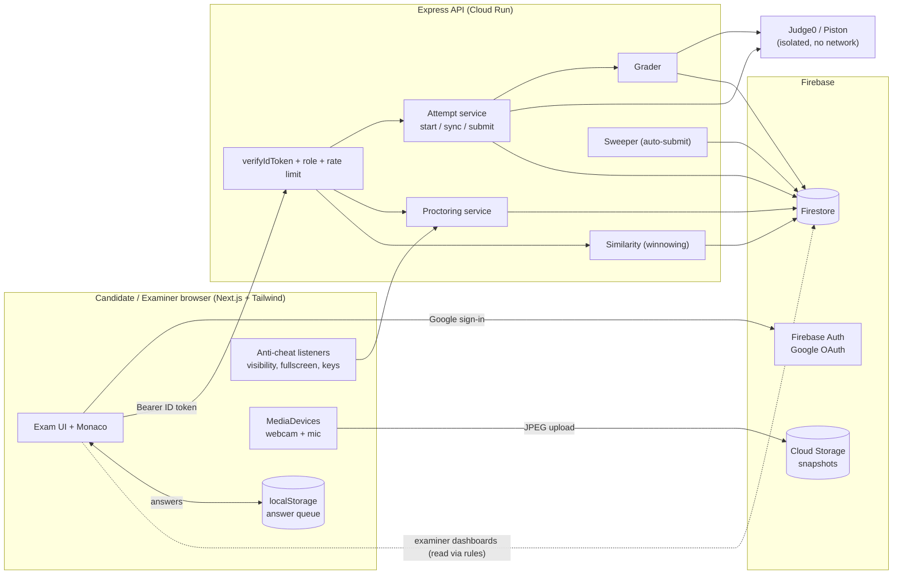
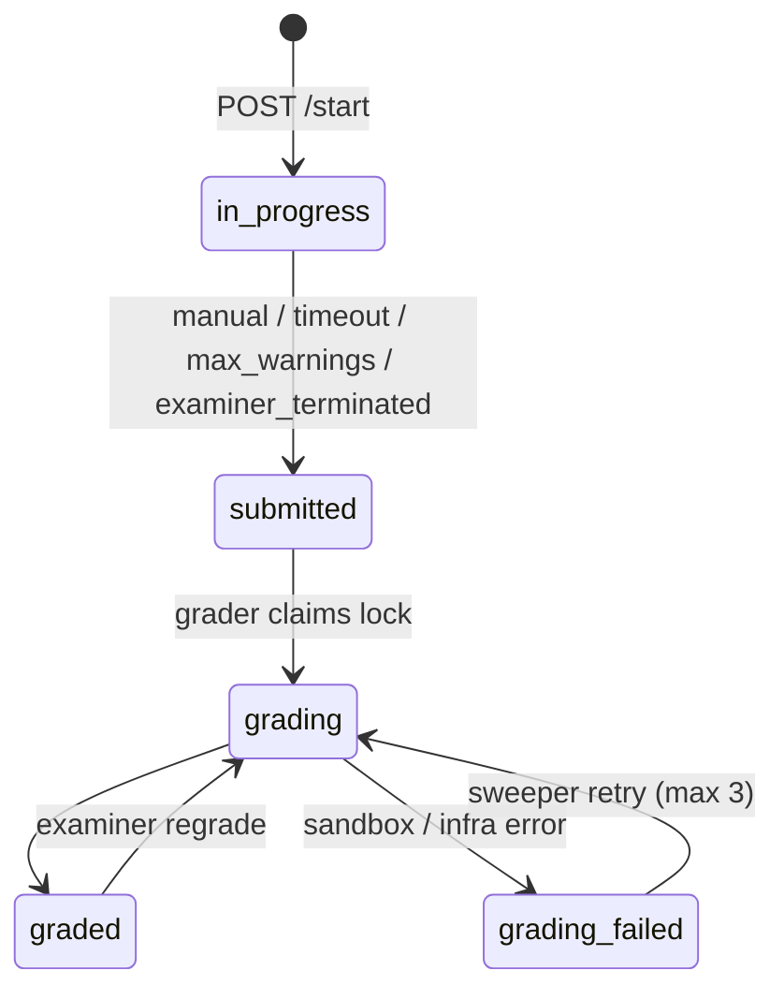
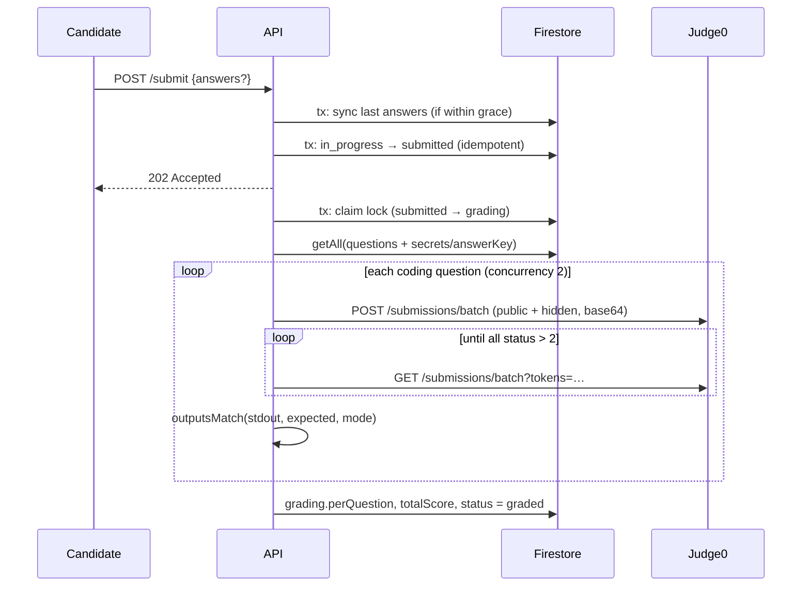

# Online Examination Platform: Architecture

> Steps 1–2: system architecture, Firestore schema, backend and code execution.
> Steps 3–4 (exam environment UI, Monaco editor) build on the API contracts described here.

## 1. System architecture



### Trust boundaries

| Concern | Where it's enforced | Why the client can't forge it |
|---|---|---|
| Identity / role | `verifyIdToken(token, checkRevoked)` + `role` custom claim | Claims are signed by Firebase; only Admin SDK can set them |
| Google-only login | `firebase.sign_in_provider === 'google.com'` in API **and** rules | Same token check |
| Exam timer | `timing.deadlineAt` written once by the server at start | Every write calls `assertActive()` with server time |
| Question set / option order | `questionMap` frozen at start (CSPRNG) | Resume never re-rolls; client only receives the sanitized view |
| Answer keys / hidden tests | `questions/{id}/secrets/answerKey` | Rules deny candidates; API never serializes them |
| Grading | `gradeSubmission()` re-reads frozen answers + keys | Client never sends a score; the "Run" button uses public tests only |
| Warning count & auto-submit | `recordProctorEvents()` transaction | Counter lives in Firestore; client only displays it |
| Expired attempts | Sweeper finalizes `deadline + grace` | Works even if the tab is closed or `/submit` is never called |

> [!IMPORTANT]
> Candidates **never write to Firestore directly**. All candidate mutations go through the API, which uses the Admin SDK. Security rules are a second layer that lets examiners use the Firestore SDK for authoring and real-time dashboards.

## 2. Firestore schema

TypeScript source of truth: [schema.ts](../server/src/types/schema.ts).

```
users/{uid}
exams/{examId}
assignments/{examId}_{emailLower}
questions/{questionId}
  └─ secrets/answerKey                 ← examiner/server only
submissions/{examId}_{uid}             ← deterministic id = one attempt per candidate per exam
  ├─ keystrokes/{questionId}_{000042}  ← replay chunks
  ├─ events/{autoId}                   ← cheat log
  ├─ snapshots/{autoId}                ← webcam metadata (image in Storage)
  └─ runs/{autoId}                     ← "Run code" history
similarityReports/{examId}_{questionId}
```

### `users/{uid}`
```json
{
  "uid": "Gq9...",
  "email": "asha@college.edu",
  "displayName": "Asha Rao",
  "photoURL": "https://lh3.googleusercontent.com/...",
  "role": "candidate",
  "createdAt": "<Timestamp>",
  "lastLoginAt": "<Timestamp>"
}
```

### `exams/{examId}`
```json
{
  "title": "DSA Mid-Term",
  "description": "Arrays, hashing, DP",
  "instructions": "## Rules\n- Fullscreen is mandatory...",
  "createdBy": "examinerUid",
  "status": "published",
  "durationMinutes": 90,
  "window": { "opensAt": "<Timestamp>", "closesAt": "<Timestamp>" },
  "sections": [
    {
      "id": "sec-mcq",
      "title": "Fundamentals",
      "poolQuestionIds": ["q01", "q02", "q03", "q04", "q05", "q06", "q07", "q08"],
      "drawCount": 5,
      "shuffleQuestions": true,
      "pointsPerQuestion": 2
    },
    {
      "id": "sec-code",
      "title": "Coding",
      "poolQuestionIds": ["c01", "c02", "c03"],
      "drawCount": 2,
      "shuffleQuestions": false,
      "pointsPerQuestion": null
    }
  ],
  "settings": {
    "shuffleOptions": true,
    "allowedLanguages": ["python", "cpp", "java", "javascript"],
    "maxWarnings": 3,
    "requireFullscreen": true,
    "requireWebcam": true,
    "requireMicrophone": true,
    "snapshotIntervalSec": 60,
    "audioThresholdDb": -30,
    "gracePeriodSec": 15,
    "showResultsToCandidate": false
  },
  "totalPoints": 50,
  "createdAt": "<Timestamp>",
  "updatedAt": "<Timestamp>"
}
```

### `assignments/{examId}_{emailLower}`
Invites by email, so a candidate can be assigned before their first login.
```json
{
  "examId": "dsa-mid",
  "examTitle": "DSA Mid-Term",
  "candidateEmail": "asha@college.edu",
  "candidateUid": null,
  "assignedBy": "examinerUid",
  "assignedAt": "<Timestamp>",
  "status": "assigned"
}
```

### `questions/{questionId}` + `secrets/answerKey`

````carousel
```json
// questions/q01 (MCQ)
{
  "bankId": "dsa-bank",
  "type": "mcq",
  "title": "Hash map lookup",
  "prompt": "Average-case complexity of `get` in a hash map?",
  "points": 2,
  "difficulty": "easy",
  "tags": ["hashing"],
  "options": [
    { "id": "a", "text": "O(1)" },
    { "id": "b", "text": "O(log n)" },
    { "id": "c", "text": "O(n)" },
    { "id": "d", "text": "O(n log n)" }
  ],
  "createdBy": "examinerUid",
  "version": 3,
  "createdAt": "<Timestamp>",
  "updatedAt": "<Timestamp>"
}
// questions/q01/secrets/answerKey
{ "type": "mcq", "correctOptionId": "a" }
```
<!-- slide -->
```json
// questions/q07 (Numerical)
{
  "bankId": "dsa-bank",
  "type": "numerical",
  "title": "Tree height",
  "prompt": "Minimum height of a binary tree with 1000 nodes?",
  "unit": null,
  "points": 2,
  "difficulty": "medium",
  "tags": ["trees"],
  "createdBy": "examinerUid",
  "version": 1
}
// questions/q07/secrets/answerKey
{
  "type": "numerical",
  "value": 9,
  "tolerance": { "mode": "absolute", "amount": 0 }
}
```
<!-- slide -->
```json
// questions/c01 (Coding)
{
  "bankId": "dsa-bank",
  "type": "coding",
  "title": "Two Sum",
  "prompt": "Read n, the array and target. Print the two indices...",
  "points": 15,
  "difficulty": "medium",
  "tags": ["arrays", "hashing"],
  "starterCode": {
    "python": "import sys\n\ndef solve():\n    pass\n\nsolve()\n",
    "cpp": "#include <bits/stdc++.h>\nusing namespace std;\nint main(){\n}\n"
  },
  "publicTestCases": [
    { "id": "p1", "input": "4\n2 7 11 15\n9\n", "expectedOutput": "0 1", "weight": 1,
      "explanation": "2 + 7 = 9" }
  ],
  "limits": { "cpuTimeSec": 2, "memoryKb": 262144 },
  "comparison": "trimmed",
  "createdBy": "examinerUid",
  "version": 5
}
// questions/c01/secrets/answerKey
{
  "type": "coding",
  "hiddenTestCases": [
    { "id": "h1", "input": "2\n3 3\n6\n", "expectedOutput": "0 1", "weight": 1 },
    { "id": "h2", "input": "<100k numbers>", "expectedOutput": "4512 88123", "weight": 3 }
  ]
}
```
````

### `submissions/{examId}_{uid}`

```json
{
  "examId": "dsa-mid",
  "candidateUid": "Gq9...",
  "candidateEmail": "asha@college.edu",
  "candidateName": "Asha Rao",
  "status": "in_progress",
  "submitReason": null,

  "examSnapshot": {
    "title": "DSA Mid-Term",
    "allowedLanguages": ["python", "cpp", "java", "javascript"],
    "maxWarnings": 3,
    "gracePeriodSec": 15
  },

  "timing": {
    "startedAt": "<Timestamp 10:00:03>",
    "deadlineAt": "<Timestamp 11:30:03>",
    "submittedAt": null
  },

  "questionMap": [
    { "questionId": "q06", "sectionId": "sec-mcq", "type": "mcq", "points": 2, "order": 0,
      "optionOrder": ["c", "a", "d", "b"], "questionVersion": 2 },
    { "questionId": "q07", "sectionId": "sec-mcq", "type": "numerical", "points": 2, "order": 1,
      "optionOrder": null, "questionVersion": 1 },
    { "questionId": "c01", "sectionId": "sec-code", "type": "coding", "points": 15, "order": 5,
      "optionOrder": null, "questionVersion": 5 }
  ],

  "answers": {
    "q06": { "type": "mcq", "selectedOptionId": "a",
             "clientSeq": 4, "clientSavedAt": 1791180123456, "serverSyncedAt": "<Timestamp>" },
    "q07": { "type": "numerical", "value": "9",
             "clientSeq": 1, "clientSavedAt": 1791180200000, "serverSyncedAt": "<Timestamp>" },
    "c01": { "type": "coding", "language": "python", "code": "import sys\n...",
             "clientSeq": 57, "clientSavedAt": 1791181000000, "serverSyncedAt": "<Timestamp>" }
  },

  "sync": {
    "lastServerSyncAt": "<Timestamp>",
    "lastClientSavedAt": 1791181000000,
    "syncCount": 112
  },

  "proctoring": {
    "warningCount": 1,
    "tabSwitches": 1,
    "fullscreenExits": 0,
    "clipboardAttempts": 2,
    "blockedShortcuts": 1,
    "audioFlags": 0,
    "snapshotCount": 41,
    "lastViolationAt": "<Timestamp>",
    "lastHeartbeatAt": "<Timestamp>"
  },

  "keystrokeStats": {
    "c01": { "chunks": 14, "events": 3120, "typedChars": 1840, "pastedChars": 0, "largeInserts": 0 }
  },

  "grading": {
    "attempts": 0, "startedAt": null, "gradedAt": null, "lastError": null,
    "totalScore": null, "maxScore": null, "perQuestion": {}
  },

  "client": { "userAgent": "Mozilla/5.0 ...", "ip": "203.0.113.7" }
}
```

**Status machine**



**Offline sync design.** Each question has its own `clientSeq` counter on the client. Every edit is written to `localStorage` straight away, and the queue is flushed to `POST /sync` every 30 s and on the `online` event. The server keeps a write only if `clientSeq > stored.clientSeq`. Replays and out-of-order retries are reported as `stale` and never overwrite newer work. `clientSavedAt` is stored for analytics only. Deadlines always use server time plus `gracePeriodSec`.

### Subcollections

```json
// submissions/{id}/keystrokes/c01_000003   (≈ every 5 s or 500 events, whichever first)
{
  "questionId": "c01",
  "chunkSeq": 3,
  "language": "python",
  "clientStartedAt": 1791180500000,
  "events": [
    { "t": 0,    "k": "f" },
    { "t": 120,  "k": "e", "o": 42, "d": 0, "i": "f" },
    { "t": 245,  "k": "e", "o": 43, "d": 0, "i": "o" },
    { "t": 9100, "k": "e", "o": 44, "d": 3, "i": "" },
    { "t": 9800, "k": "l", "v": "cpp", "i": "#include <bits/stdc++.h>\n..." },
    { "t": 12000,"k": "b" }
  ],
  "serverReceivedAt": "<Timestamp>"
}

// submissions/{id}/events/{auto}
{ "type": "tab_hidden", "clientTs": 1791180777000, "serverTs": "<Timestamp>",
  "countedAsViolation": true, "meta": { "durationMs": 4200 } }

// submissions/{id}/snapshots/{auto}
{ "storagePath": "proctoring/dsa-mid/Gq9.../1791180800000.jpg", "clientTs": 1791180800000,
  "serverTs": "<Timestamp>", "audioLevelDb": -41.5, "flagged": false, "flags": [] }

// submissions/{id}/runs/{auto}
{ "questionId": "c01", "language": "python", "codeSha256": "9f2c...", "mode": "tests",
  "passed": 1, "total": 2, "serverTs": "<Timestamp>" }
```

> [!NOTE]
> Firestore doesn't allow nested arrays, so keystroke events are stored as small maps with one-letter keys. Chunking keeps each document well under the 1 MiB limit. Indexing is disabled on `keystrokes.events` and `submissions.answers` in `firestore.indexes.json`, which cuts write cost.

### `similarityReports/{examId}_{questionId}`
```json
{
  "examId": "dsa-mid",
  "questionId": "c01",
  "generatedAt": "<Timestamp>",
  "generatedBy": "examinerUid",
  "algorithm": { "name": "winnowing", "k": 6, "w": 5, "minTokens": 25 },
  "threshold": 0.6,
  "comparedSubmissions": 118,
  "pairs": [
    { "submissionA": "dsa-mid_u1", "submissionB": "dsa-mid_u9",
      "candidateA": "a@x.edu", "candidateB": "b@x.edu", "language": "python",
      "jaccard": 0.81, "containment": 0.93, "sharedFingerprints": 54 }
  ]
}
```

## 3. Backend API

| Method & path | Role | Purpose |
|---|---|---|
| `GET /api/time` | any | `serverNow` for the client's clock offset |
| `POST /api/auth/session` | signed-in | Upsert profile, assign role claim |
| `POST /api/attempts/exams/:examId/start` | assigned candidate | Create or resume attempt, returns `deadlineAt` |
| `GET /api/attempts/:id` | owner | Sanitized questions + saved answers |
| `POST /api/attempts/:id/sync` | owner | Batched autosave (`clientSeq`-guarded) |
| `POST /api/attempts/:id/events` | owner | Proctor events → server warning count / auto-submit |
| `POST /api/attempts/:id/keystrokes` | owner | Replay chunk (idempotent) |
| `POST /api/attempts/:id/run` | owner, 10/min | Public tests or custom stdin |
| `POST /api/attempts/:id/submit` | owner | Final flush + finalize, grading is async (202) |
| `POST /api/examiner/exams/:examId/similarity` | exam owner | Run plagiarism scan |
| `POST /api/examiner/submissions/:id/regrade` | exam owner | Force regrade |
| `POST /api/examiner/submissions/:id/terminate` | exam owner | Force-submit a live attempt |

### Grading pipeline



- **Comparison modes** ([compare.ts](../server/src/services/grading/compare.ts)): `exact`, `trimmed` (default), `tokens`, `float` (relative tolerance).
- **Partial credit**: `points × passedWeight / totalWeight` across public and hidden tests.
- **Sandbox failures** (`internal_error`) throw instead of scoring 0, so a Judge0 outage never penalizes a candidate. The sweeper retries up to 3 times.
- `expected_output` is **never sent to Judge0**. Comparison happens on our server, so hidden outputs stay inside our infrastructure.

## 4. Code similarity (plagiarism)

Implementation: [similarity.ts](../server/src/services/plagiarism/similarity.ts), [tokenize.ts](../server/src/services/plagiarism/tokenize.ts), [winnow.ts](../server/src/services/plagiarism/winnow.ts).

1. **Normalize**: tokenize per language. Comments and whitespace are dropped, identifiers become `V`, strings become `S`, numbers become `N`, and keywords and operators are kept. Renaming variables or reformatting has no effect.
2. **Fingerprint**: hash every 6-token k-gram (FNV-1a), then **winnow** with window 5. This is the MOSS algorithm, and it guarantees that any shared run of at least 10 tokens is caught.
3. **Remove noise**: subtract fingerprints that come from the starter code, and drop fingerprints that appear in more than 50 % of submissions (common idioms).
4. **Pair efficiently**: an inverted index from fingerprint to submissions means only pairs that share something get scored.
5. **Score**: `containment = |A∩B| / min(|A|,|B|)` catches a copied solution wrapped in extra code. `jaccard` is also reported. Pairs above the threshold (default 0.6) go to `similarityReports`.
6. **Corroborate**: the dashboard should combine similarity with the keystroke signals (`pastedChars`, `largeInserts`, typing cadence) and replay. A high-similarity pair where one side was typed naturally and the other appeared in large inserts is strong evidence.

> [!TIP]
> For large cohorts (>2k submissions per question), move the scan into a Cloud Run Job or Cloud Function triggered after the exam window closes. For cross-language or AST-level detection, [Dolos](https://dolos.ugent.be/) or JPlag can sit behind the same `similarityReports` contract.

## 5. Running the backend

```bash
cd server
cp .env.example .env          # fill Firebase + Judge0 credentials
npm install
npm run dev                   # http://localhost:8080
npm run set-role -- teacher@example.com examiner

# deploy rules & indexes
firebase deploy --only firestore:rules,firestore:indexes,storage
```

> [!WARNING]
> For real exams, **self-host Judge0** (or Piston) on an isolated VM with networking disabled. Public RapidAPI quotas and latency will not hold up when a whole class hits Submit at the same moment.
